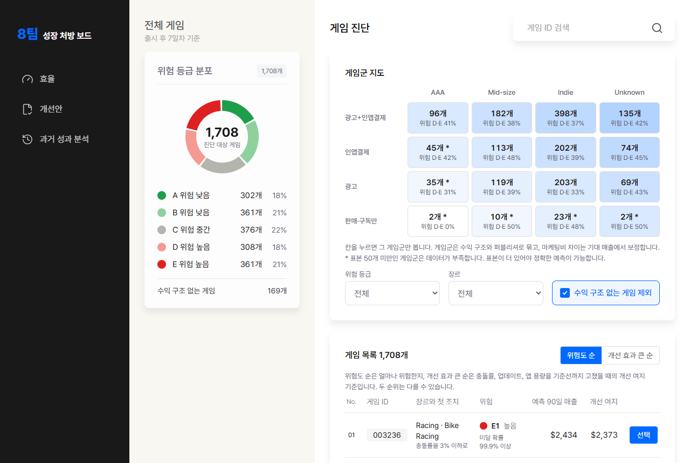
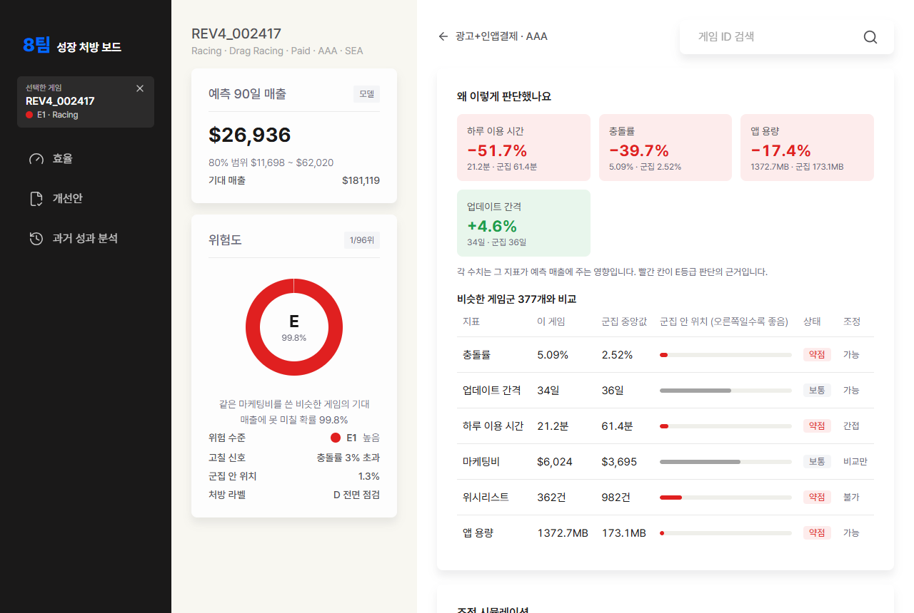
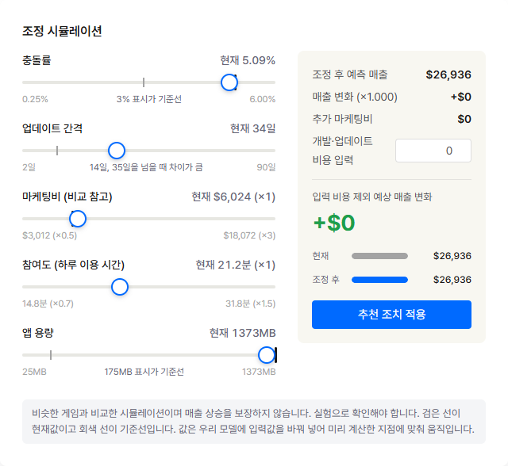

# D7 성장 처방 보드

**출시 7일 차 지표로 90일 매출을 예측하고, 비슷한 게임과 비교한 위험 등급과 "무엇부터 고칠지" 우선순위를 보여 주는 대시보드입니다.**
제3회 DArt-B × Parrot 연합 데이터톤(중앙대 DArt-B × 서강대 Parrot) 8조의 결과물입니다.

**바로 보기:** https://jinuuuuuuuuuuu.github.io/d7-growth-board/
**데모 게임:** [REV4_002417 (위험 E)](https://jinuuuuuuuuuuu.github.io/d7-growth-board/#/game/REV4_002417) · [REV4_008978 (효율 시연용)](https://jinuuuuuuuuuuu.github.io/d7-growth-board/#/game/REV4_008978)

| 진단 | 게임 상세 |
|---|---|
|  |  |
| **조정 시뮬레이션** | **효율** |
|  |  |

## 풀려는 문제

게임을 여러 개 운영하는 회사는 출시 7일 만에 "어떤 게임의 무엇을 먼저 고칠지" 정해야 하지만, 결과는 90일 뒤에야 나옵니다. 매출 순위만 보면 규모가 작은 게임을 위험하다고 착각하고, 개선 여지가 큰 "안전해 보이는 게임"을 놓칩니다. 그래서 **비슷한 게임과 비교해 위험과 기회를 함께 보는 기준**이 필요합니다.

## 핵심 기능

1. **게임군 분류** — 수익 구조 4 × 퍼블리셔 규모 4 = 16개 게임군. 지도에서 칸을 누르면 목록과 위험 등급 분포가 그 게임군으로 바뀝니다.
2. **위험 등급 (A~E)** — 같은 마케팅비를 쓴 비슷한 게임의 기대 매출에 못 미칠 확률. 지표별 강점·약점도 함께 보여 줍니다.
3. **조정 시뮬레이션** — 충돌률, 업데이트 간격, 하루 이용 시간, 마케팅비, 앱 용량을 슬라이더로 바꾸면 모델이 다시 예측한 매출을 보여 줍니다.
4. **효율** — 조치별 "1달러당 늘어나는 매출"로 예산을 배분하고, 게임 하나의 조치별 손익을 보여 줍니다.
5. **개선안·과거 성과** — 대상·가설·실행안·성공 지표·관찰 기간을 채운 개선안을 저장하고, 같은 게임군에서 지표가 가장 비슷한 학습 게임 10개의 실제 매출을 비교합니다.

한 번 고른 게임은 왼쪽에 고정되어 효율·개선안·과거 성과가 모두 그 게임에 연동됩니다.

## 계산 방식

```
미달 확률 = Φ( (ln 기대 매출 − ln 예측 매출) ÷ σ )          σ = 0.651
기대 매출 = 게임군 기준값 × (내 마케팅비 ÷ 게임군 마케팅비 중앙값)^탄력성
```

| 등급 | 미달 확률 | 학습 게임 검증 (예측 → 실제 미달 비율) |
|---|---|---|
| A | 20% 미만 | 10.6% → 10.1% |
| B | 20~40% | 30.2% → 29.6% |
| C | 40~60% | 49.8% → 49.6% |
| D | 60~80% | 69.9% → 71.1% |
| E | 80% 이상 | 90.5% → 91.2% |

- **예측 모델:** 채널별 LightGBM + CatBoost + 선형 회귀를 로그 척도에서 1/3씩 평균 (교차검증 RMSLE 0.6714). 무료이면서 광고·인앱결제가 없는 게임은 규칙으로 0 처리.
- **게임군 기준:** 매출 차이를 가장 잘 설명하는 수익 구조(11.7%)와 퍼블리셔 규모(6.1%)로 묶고, 마케팅비는 묶음 기준이 아니라 기대 매출 보정으로 반영합니다. 그래서 위험 판정이 "예산이 적어서"가 아니라 "같은 조건에서 뒤처져서"를 뜻합니다.
- **시뮬레이션 변수 5개:** 다른 요인을 통제해도 매출 영향이 크고, 운영팀이 바꾸거나 비교할 수 있고, 모델로 다시 예측할 수 있는 변수입니다. (충돌률 1%p당 0.83배, 업데이트 35일 초과 0.61배, 이용 시간 2배 1.65배, 마케팅비 2배 1.48배, 앱 용량 175MB 초과 0.86배)
- **효율:** 스토어 수수료 30%를 떼고 본전이 되려면 1달러당 1.43달러 이상이어야 하므로 이 선을 넘지 못하는 조치는 고르지 않습니다.

## 데이터와 한계

- 합성 데이터 기반이며 **실제 시장 통계가 아닙니다.** 학습 8,000개로 모델과 기준값을 만들고, 테스트 2,000개 중 수익 구조가 없는 게임과 마케팅비가 비어 있는 게임을 뺀 **1,708개**를 진단합니다.
- 모든 조정 효과는 비슷한 게임끼리 비교한 **연관 기반 추정**이며 매출 상승을 보장하지 않습니다. 실험으로 확인해야 합니다.
- 조치 단가·실현율·수수료는 **데이터에 없는 팀의 가정값**이고 화면에서 수정할 수 있습니다.
- 위험 등급 검증은 학습 게임 기준입니다. 테스트 게임은 실제 매출이 없어 같은 방식으로 검증할 수 없습니다.
- 7일치 데이터라 출시 이후의 변화를 실시간으로 반영하지 못하고, 실제 경쟁작 데이터가 없어 데이터상 비슷한 게임과의 비교만 가능합니다.

## 실행

```
npm ci
npm run dev
```

배포본은 `npm run build`로 만들고, 브라우저 시험(78개)은 `npx vite preview --port 4173` 뒤 `python e2e/check.py`로 실행합니다. 화면의 수치는 모델로 미리 계산한 값(`public/data`)이며 화면에서 새 숫자를 만들지 않습니다.

## 기술 스택

React 19 · TypeScript · Vite · React Router(HashRouter) · 순수 CSS · 직접 그린 SVG 차트 · GitHub Pages

## 출처

- 화면 구성: Mahmud Saeef, Car Rental Company Dashboard UI (Figma Community, 교육 목적 무료)
- 글꼴: Pretendard (SIL Open Font License, `public/fonts/Pretendard-LICENSE.txt`)
