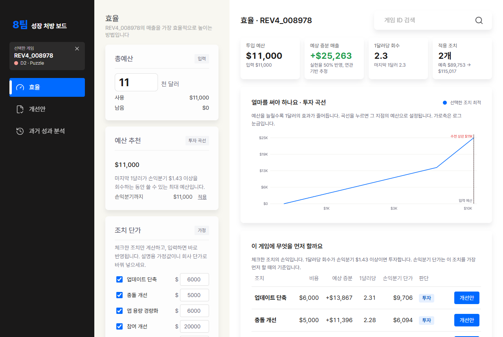

<div align="center">

# 🎮 D7 성장 처방 보드

### 출시 7일 차 지표로 "어떤 게임의 무엇부터 고칠지" 정하는 대시보드

**90일 매출을 예측하고, 비슷한 게임과 비교한 위험 등급과 개선 우선순위를 함께 보여 줍니다.**

제3회 DArt-B × Parrot 연합 데이터톤 (중앙대 DArt-B × 서강대 Parrot) · 8조

[대시보드 바로 보기](https://jinuuuuuuuuuuu.github.io/Game-Revenue-Growth/)

</div>

<p align="center">
  
  
</p>
<p align="center">
  
  
</p>

---

## 🎯 프로젝트 개요

게임을 여러 개 운영하는 회사는 출시 7일 만에 개선할 게임을 골라야 하지만, 결과는 90일 뒤에야 나옵니다.

- 매출 순위만 보면 **규모가 작은 게임을 위험하다고 착각**하기 쉽습니다.
- 개선 여지가 큰 **"안전해 보이는 게임"을 놓칩니다.** 분석 결과 위험도가 낮은 A·B 등급 게임이 전체 개선 여지의 약 41%를 차지했습니다.
- 마케팅비가 매출에 가장 큰 영향을 주기 때문에, 단순 비교하면 **예산이 적은 게임만 위험하게** 나옵니다.

그래서 본 프로젝트는 **비슷한 게임끼리 묶어 위험과 기회를 함께 보고, 무엇부터 고칠지 정해 주는 기준**을 만들었습니다.

| 설계 원칙 | 구현 방식 |
| --- | --- |
| 🧩 비슷한 게임끼리 비교 | 수익 구조 4 × 퍼블리셔 규모 4 = 16개 게임군 |
| ⚖️ 예산 차이는 보정 | 마케팅비는 묶음 기준이 아니라 기대 매출 보정으로 반영 |
| 🎚️ 바꿀 수 있는 변수만 조정 | 충돌률·업데이트 간격·이용 시간·마케팅비·앱 용량 5개 |
| 💰 비용 대비 효과로 우선순위 | 조치별 "1달러당 늘어나는 매출"로 예산 배분 |
| 🚧 한계는 화면에 명시 | 연관 기반 추정과 팀 가정값을 검증값과 구분해 표시 |

---

## 🧭 핵심 기능

| 기능 | 내용 |
| --- | --- |
| 🗺️ 게임군 지도 | 16칸 지도에서 게임군을 고르면 목록과 위험 등급 분포가 그 게임군으로 바뀜 |
| 🚦 위험 등급 (A~E) | 같은 조건의 비슷한 게임보다 매출이 못 미칠 확률, 지표별 강점·약점 |
| 🎚️ 조정 시뮬레이션 | 지표 5개를 슬라이더로 바꾸면 모델이 다시 예측한 매출 표시 |
| 💰 효율 | 조치별 투자 효율로 예산을 배분하고, 게임 하나의 조치별 손익 확인 |
| 📝 개선안·과거 성과 | 대상·가설·실행안·성공 지표·관찰 기간을 채운 개선안 저장, 지표가 비슷한 학습 게임 10개의 실제 매출 비교 |

> 한 번 고른 게임은 화면에 고정되어 효율·개선안·과거 성과가 모두 그 게임에 연동됩니다.

---

## 🧮 계산 방식

```text
미달 확률 = Φ( (ln 기대 매출 − ln 예측 매출) ÷ σ )          σ = 0.651
기대 매출 = 게임군 기준값 × (내 마케팅비 ÷ 게임군 마케팅비 중앙값)^탄력성
```

| 등급 | 미달 확률 | 학습 게임 검증 (예측 → 실제 미달 비율) |
| --- | --- | --- |
| A | 20% 미만 | 10.6% → 10.1% |
| B | 20~40% | 30.2% → 29.6% |
| C | 40~60% | 49.8% → 49.6% |
| D | 60~80% | 69.9% → 71.1% |
| E | 80% 이상 | 90.5% → 91.2% |

- **예측 모델:** 채널별 LightGBM + CatBoost + 선형 회귀를 로그 척도에서 1/3씩 평균 (교차검증 RMSLE 0.6714, Public 0.6354)
- **게임군 기준:** 매출 차이를 가장 잘 설명하는 수익 구조(11.7%)와 퍼블리셔 규모(6.1%)로 묶음. 장르를 더하면 오차는 거의 줄지 않고 군집만 잘게 쪼개져 제외
- **마케팅비 보정:** 보정 전 위험도와 마케팅비의 상관이 −0.82였으나, 보정 후 −0.006으로 줄어 위험 등급이 "같은 조건에서 뒤처져서"를 뜻하게 됨
- **시뮬레이션 효과 (다른 요인 통제 후):** 충돌률 1%p당 0.83배, 업데이트 35일 초과 0.61배, 이용 시간 2배 1.65배, 마케팅비 2배 1.48배, 앱 용량 175MB 초과 0.86배
- **효율 기준:** 스토어 수수료 30%를 떼고 본전이 되려면 1달러당 1.43달러 이상이어야 하므로, 이 선을 넘지 못하는 조치는 선택하지 않음

---

## 📈 주요 결과

| 항목 | 값 |
| --- | ---: |
| 진단 대상 게임 | 1,708개 |
| 위험 등급 분포 | A 302 · B 361 · C 376 · D 308 · E 361 |
| 예측 90일 매출 합계 | 약 1억 5,400만 달러 |
| 지표 개선 시 늘어날 수 있는 매출 | 약 4,000만 달러 (26%) |
| 비용을 회수하는 조치가 있는 게임 | 약 22% |

> 상위 10% 게임에 개선 여지의 절반 이상이 몰려 있습니다. **모든 게임을 고치는 것이 아니라, 고칠 가치가 있는 게임을 골라내는 것**이 핵심입니다.

---

## ⚠️ 데이터와 한계

- 합성 데이터 기반이며 실제 시장 통계가 아닙니다. 학습 8,000개로 모델과 기준값을 만들고, 테스트 2,000개 중 수익 구조나 마케팅비가 없는 게임을 뺀 1,708개를 진단합니다.
- 모든 조정 효과는 비슷한 게임끼리 비교한 연관 기반 추정이며, 실제 효과는 실험으로 확인해야 합니다.
- 조치 단가·실현율·수수료는 데이터에 없는 팀의 가정값이며 화면에서 수정할 수 있습니다.
- 위험 등급 검증은 학습 게임 기준입니다. 테스트 게임은 실제 매출이 없어 같은 방식으로 검증할 수 없습니다.

---

## 📁 프로젝트 구조

```text
📦 Game-Revenue-Growth
├── 📂 src/
│   ├── 📂 pages/        # 진단 · 게임 상세 · 효율 · 개선안 · 과거 성과
│   ├── 📂 components/   # 게임 표, 투자 곡선, 슬라이더
│   └── 📂 lib/          # 데이터 로딩, 예산 배분, 형식 변환
├── 📂 public/data/      # 모델로 미리 계산한 화면 수치
├── 📂 e2e/              # 브라우저 시험 78개
└── 📂 docs/             # README 화면 캡처
```

## ⚒️ 기술 스택

| 영역 | 기술 |
| --- | --- |
| 🧠 모델 | LightGBM, CatBoost, 선형 회귀 |
| 🖥️ 화면 | React 19, TypeScript, Vite, React Router |
| 📊 차트 | 직접 그린 SVG |
| 🧪 시험 | Playwright |
| 🚀 배포 | GitHub Pages |

## 🚀 실행 방법

```bash
npm ci
npm run dev
```

배포본은 `npm run build`로 만듭니다. 브라우저 시험은 `npx vite preview --port 4173`을 띄운 뒤 `python e2e/check.py`로 실행합니다. 화면의 수치는 모델로 미리 계산한 값(`public/data`)입니다.

---

## 📎 출처

- 화면 구성 참고: Mahmud Saeef, Car Rental Company Dashboard UI (Figma Community, 교육 목적 무료)
- 글꼴: Pretendard (SIL Open Font License, `public/fonts/Pretendard-LICENSE.txt`)
